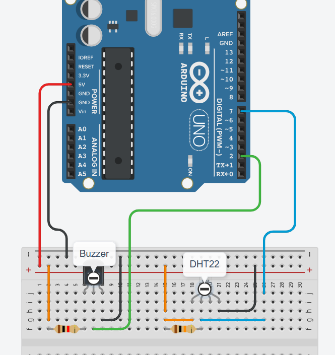
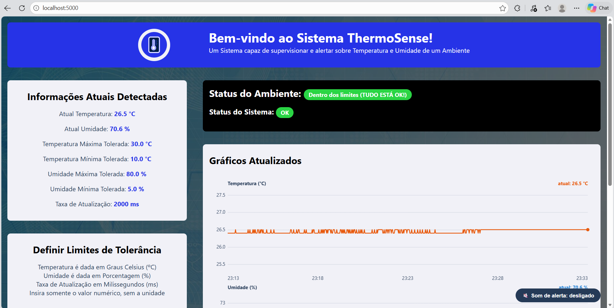
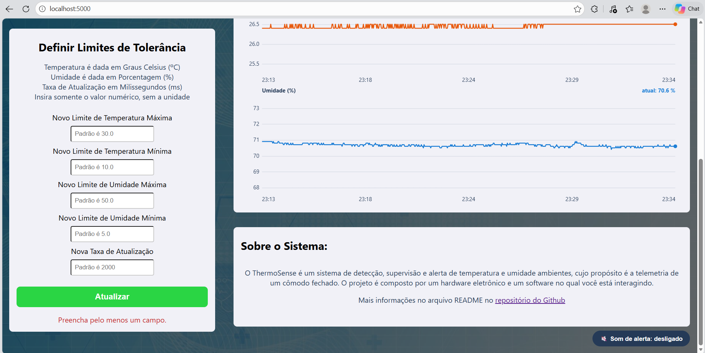
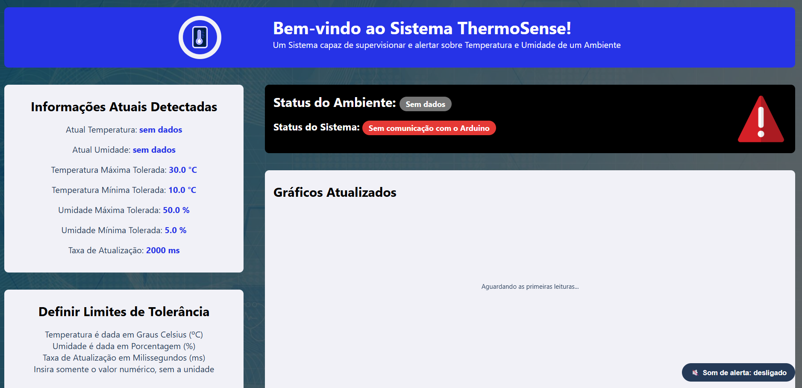

# Projeto do Sistema ThermoSense

**PROJETO FEITO POR RAFAEL RAMOS OTTONI DE CASTRO**

Este projeto consiste em um sistema integrado de detecção, supervisão e alerta de temperatura e umidade ambientes.

Funciona com dois módulos, **um hardware (composto por um sistema com Arduino)** e **um software (uma aplicação web com um dashboard)**.
O sistema alerta **sempre que a temperatura ou umidade estiverem fora de um limite definido**. Pelo software, avisos visuais e sonoros informam o usuário desse problema. Pelo hardware, o sistema emite sons de 2000Hz para chamar mais a atenção.

Para replicar o projeto, **deve-se seguir o passo-a-passo**.

## CONFIGURAÇÃO DE HARDWARE

Módulos e Equipamentos Usados:

* Microcontrolador (de sua preferência)
    * Foi utilizado um UNO Atmega328 Ch340
* Sensor de Temperatura e Umidade
    * Foi utilizado um DHT22 Duaitek
* Buzzer de 5V
    * Foi utilizado um buzzer passivo
* Protoboard
* Cabo USB tipo B
* Cabos Jumper Macho-Macho

### Montagem do hardware

O Hardware deve seguir esse diagrama.
O Microcontrolador **deve estar conectado** a um computador pelo cabo USB tipo B



## FUNCIONALIDADES DO SOFTWARE

O dashboard é o software onde é possível monitorar os valores recebidos do hardware. Informações sobre instalação no computador na seção seguinte a essa.

Assim se parece o dashboard





#### Painel de Informação (Lateral):
É possível ver os dados atuais, limites de temperatura, limites de umidade e taxa de atualização. 

#### Painel de Reconfiguração (Lateral):
Todos esses dados são reconfiguráveis pelo painel lateral. Uma vez que quaisquer dados são reconfigurados, o arduino reseta e mudança é aplicada.

#### Painel de Status (Painel de Fundo Preto):
Cobre o status de Ambiente e status de Sistema.
Status de Ambiente são informações sobre a temperatura e umidade, se estão altos demais, baixos demais ou se estão dentro dos limites definidos.
Status de Sistema são informações do servidor e conexões do arduino, apresentando o problema (se houver) ou se estão operando corretamente (OK).

#### Painel de Gráficos Atualizados
São exibidas as variações de temperatura (gráfico superior) e variações de umidade (gráfico inferior).
Ao redefinir um limite de tolerância, o gráfico pausa sua atualização e espera o arduino reiniciar.
Se o a comunicação com servidor for encerrada (geralmente usando Ctrl + C no terminal), o gráfico para. Se o servidor for reiniciado, o gráfico reinicia também, apagando informações anteriores.
Cada gráfico **renderiza até 20.000 pontos**, depois disso, os pontos mais antigos são descartados

#### Painel sobre o Sistema
Apenas informações básicas sobre o sistema e o link para esse repositório do GitHub.

#### Sistema de Alerta
No canto inferior direito, existe a opção de ativar ou desativar alarmes sonoros pelo computador, por padrão está desativada.


## INSTALAÇÃO DE SOFTWARE

Clonando os arquivos 

1. Clone este repositório em seu computador, onde preferir.
2. No VS Code (ou sua IDE de programação), abra o diretório raíz do thermosense no terminal e insira:
``` py -m  pip install pyserial```

Configurando Arduino IDE

3. Tenha Arduino IDE baixado, [link para download] (https://www.arduino.cc/en/software/).
4. Abra o arquivo "thermosense/arduino/arduino.ino" no Arduino IDE.
5. No Arduino IDE, selecione no botão "Board and Port" 
6. Para Board use Arduino UNO, para Port use COM3 Serial Port
    *Nota 1: se outro tipo de arduino for usado, selecione a board respectiva do seu arduino*
    *Nota 2: se a porta COM3 não estiver disponível, use outra porta e faça as alterações no código dos arquivos, substituindo todas as instâncias em que a COM3 foi escrita*

Incluindo biblioteca do DHT22 no Arduino IDE

7. Baixe a biblioteca DHTlib por [esse link] (https://drive.google.com/file/d/1ekn2aVSsGbESw16B2oAjM6KmqMJ1mWHd/view) 
8. No Arduino IDE, selecione na guia Skecth > Include Library > Add .ZIP Library...
9. No explorador de arquivos, selecione o arquivo .zip baixado (não precisa descomprimir/deszipar).

Conectando o sistema

10. Conecte o hardware ao computador com seu USB tipo B.
11. Abra o arquivo arduino.ino e clique em upload (isso inicia a execução do arquivo).
12. Deixe executando em segundo plano no Arduino IDE

Rodando o sistema

13. Para executar o servidor, no terminal do VS Code (ou de sua IDE de programação), acesse thermosense/api e insira:
``` py servidor.py ```
14. Abra seu navegador web (preferencialmente Edge ou Firefox) e acesse:
``` localhost:5000 ```
15. Pronto! Sistema rodando.
16. (OPCIONAL) Se quiser, pode fechar Arduino IDE, pois o código está em execeução na memória do microcontrolador

O sistema vai soltar um som grave de 600Hz duas vezes e vai inicializar. O dashboard ficará assim por poucos instantes:




### Como resetar o servidor ou o arduino

Para encerrar o servidor, basta inserir Ctrl+C no terminal onde está rodando o servidor OU matar o terminal.
Para reiniciar o servidor, basta inserir "py servidor.py" no terminal em thermosense/api
Para reiniciar o arduino, aperte o pequeno botão vermelho no hardware (perto da entrada USB) OU, no dashboard, preencha um campo qualquer e clique em "Atualizar".